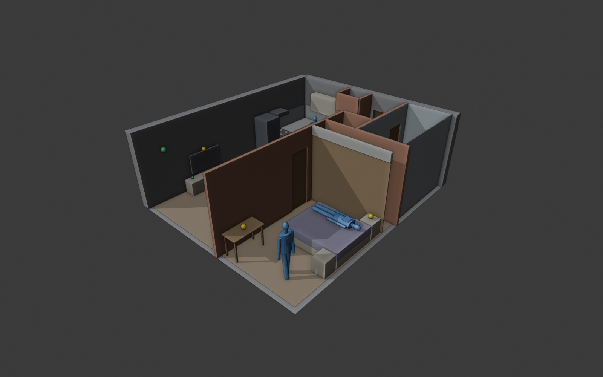
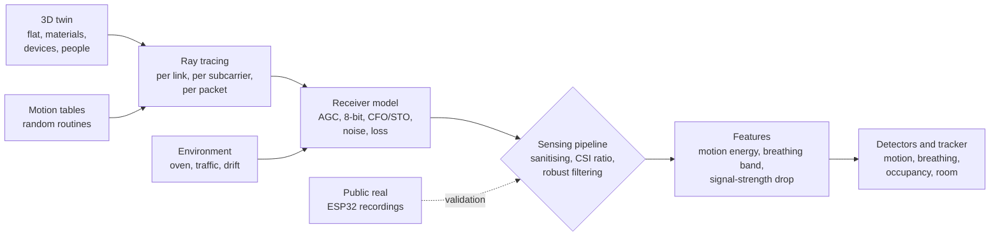
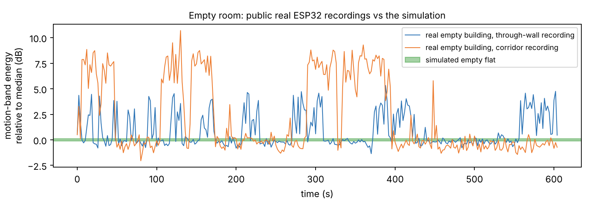
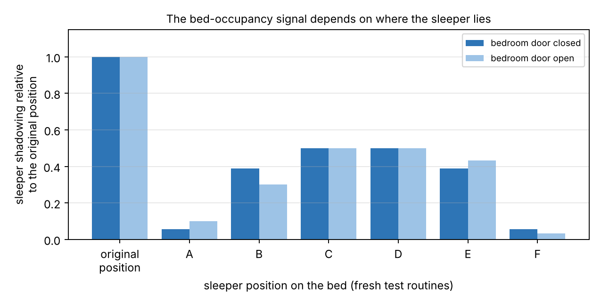
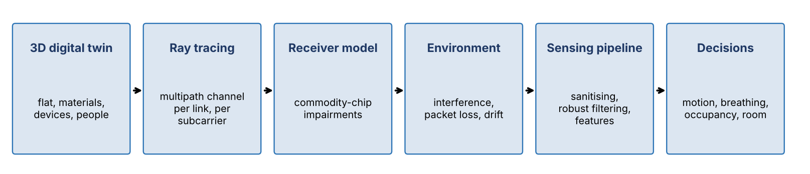
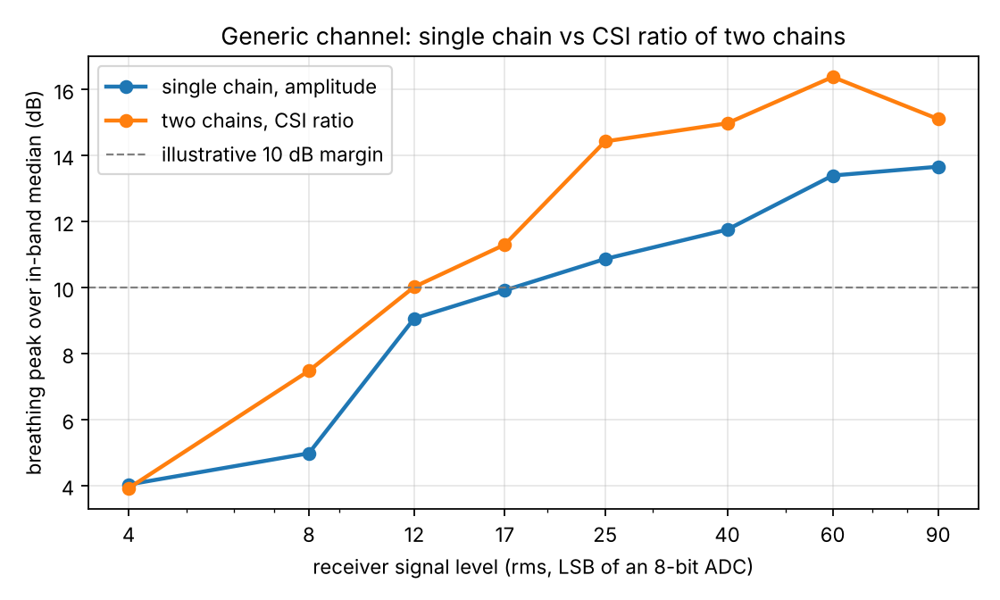

# Passive Through-Wall Human Sensing with Commodity WiFi CSI: A Digital-Twin Study

**Can ordinary WiFi devices tell that someone is moving, breathing or lying in bed in the next room, using
cheap receivers and no camera? A full digital twin of a home answers where this works and where it breaks.**


> **About this repository.** This is the public overview of a completed research project. It presents the
> problem, the simulation model, the research framework and verified qualitative results. The full
> simulation suite, scene geometry and materials, receiver calibration, detector designs and thresholds,
> generated datasets and numerical results are **withheld** pending publication. For collaboration, peer
> review or access, contact [ikhlas.sabilly@gmail.com](mailto:ikhlas.sabilly@gmail.com).

---

## The problem

Every WiFi packet carries **channel state information (CSI)**: a per-subcarrier description of how the
signal travelled from transmitter to receiver. People moving in a room change the multipath, so the CSI
changes too. In principle a router and a few smart devices could therefore sense presence, motion and even
breathing through walls. In practice four questions decide whether this is useful in a real home:

1. **Through-wall motion.** Can the system tell that someone is moving in the bedroom while another person
   is busy elsewhere in the same flat?
2. **Breathing and bed occupancy.** Can it detect a still person breathing or lying in bed, and does that
   survive other activity in the home?
3. **Where people are.** Can it say which room, or which part of a room, a moving person is in, with one or
   two people at home?
4. **Cheap hardware and real homes.** Do the answers survive 8-bit commodity receivers (ESP32 class),
   microwave ovens, busy WiFi traffic and the background activity of a real building?

Testing this on people raises privacy questions and needs large, repeatable recordings. This project
instead builds a **digital twin**: a one-bedroom flat with virtual occupants, a radio ray tracer that
computes what every WiFi link would see, and a receiver model with the imperfections of a real low-cost
chip. No real person was sensed. Because every simulated result is only as good as the simulation, part of
the study checks the twin against theory and against **public real ESP32 recordings**.

<p align="center">
  
  <br><em>The digital twin: a furnished one-bedroom flat with a walking and a sleeping occupant and the WiFi devices that serve as sensors. Dimensions, materials and device placement are withheld.</em>
</p>

## The model

| Layer | What is modelled |
|---|---|
| **Scene** | A furnished one-bedroom flat built in Blender: walls, doors (open or closed), windows and furniture with frequency-appropriate radio materials |
| **Occupants** | Articulated human models driven by motion tables: walking, lying and breathing, hand work at chores; randomised daily routines |
| **Radio channel** | GPU ray tracing (Sionna RT) of every link at 2.4 GHz, per OFDM subcarrier and per packet, with diffuse body scattering |
| **Links** | A router plus several household devices, used both as router receivers and as device-to-device links |
| **Receiver** | A commodity-chip model: noise figure, automatic gain control, 8-bit I/Q quantisation, carrier and timing offsets, packet loss; single-chain and two-chain variants |
| **Environment** | Microwave-oven bursts, bursty co-channel traffic and inter-chain phase drift |



- **Physics first.** The scene follows the ray tracer's modelling rules (single-plane walls with thickness
  in the material, no coincident surfaces), and simulated Doppler is checked against the kinematic limit
  2v/λ before any detector is built.
- **Realistic receivers.** Every receiver parameter carries a source or is labelled as an assumption; the
  signal level of real ESP32 hardware was measured from public logs rather than guessed.
- **Two-chain sensing.** Besides single-antenna processing, the study models a card with two receive chains
  sharing one clock and uses their CSI ratio to cancel common clock errors.
- **Robust pipeline.** Lost packets are kept as gaps, interference-hit packets are rejected by a robust
  outlier filter, and decisions are withheld when too few good packets remain.
- **Multi-link inference.** Device-to-device links add views of the home that the router alone cannot
  provide, used for spatial contrasts and room-level tracking.

## Research framework

The study was run as a sequence of milestones. Each answered one design question, was **pre-registered**
before its test data existed, and had to be approved before the next began.
[`docs/FRAMEWORK.md`](docs/FRAMEWORK.md) describes the method in detail.

| Stage | Design question |
|---|---|
| 1. Digital twin | Does the simulated channel behave like physics says it should (Doppler, breathing, body scattering)? |
| 2. Commodity receiver | What do 8-bit gain-controlled receivers do to motion and breathing, and what level do real chips actually run at? |
| 3. Realistic homes | Can bedroom motion and breathing be detected while another person is active, with interference, on routines never used for design? |
| 4. Localisation | Can a moving person be placed in the right zone or room, and can two people be told apart? |
| 5. Real-data check | Do the twin's assumptions hold on public real ESP32 recordings through brick walls? |
| 6. Stress test | Do the surviving claims hold once real-world variability is injected and new situations are tested? |

## Verified results (qualitative)

Acceptance criteria and predictions were written down before each test, test data were used once, and
results are judged over many receiver noise realisations with confidence intervals. Negative results are
reported as findings.

- **Through-wall motion detection works, and survives reality.** Contrasting bedroom links against
  living-room links separates a person moving in the bedroom from a person busy elsewhere almost perfectly
  in cross-validation over randomised routines. On public real ESP32 recordings through brick walls the
  same calibration rule detects walking near the receiver with very few false alarms, and it keeps passing
  when real empty-building variability is injected into the simulation.
- **Cheap receivers limit breathing.** Walking survives every receiver impairment. Breathing does not survive
  8-bit quantisation at the signal level real chips run at; long averaging or a **two-chain CSI ratio**
  recovers it, but only when the rest of the home is quiet. Slow everyday activity elsewhere in the flat
  overlaps the breathing band.
- **One person can be placed in a room; two cannot reliably.** Fingerprint tracking puts a single walking
  person in the right room most of the time; the second person of a pair is found far less often.
  Physics-only localisation fails in a multipath home.
- **The simulator's empty room is far too clean.** Real empty buildings fluctuate by several dB in the
  motion band, tens of times more than the simulation. Thresholds must be calibrated on real empty-room data.
- **A claim was retracted.** Bed occupancy from the drop in received signal strength looked robust at one
  sleeper position. On fresh routines with new positions on the bed the effect varied from strong to
  invisible. The decisive physics (a body grazing the direct path, i.e. Fresnel-zone diffraction) is outside
  what geometric ray tracing models reliably, so the claim was withdrawn rather than tuned.
- **Simulator limits were identified and quantified**: an exaggerated broadband artefact while people walk,
  coincident-surface flicker (found and fixed), and missing near-grazing diffraction.

<p align="center">
  
  <br><em>Ten minutes of an empty real building versus the simulated empty flat, relative to each signal's median. Real data: Wallhack1.8k (Strohmayer and Kampel, TU Wien; Zenodo, doi:10.5281/zenodo.13950918). Absolute levels and the study's thresholds are withheld.</em>
</p>

<p align="center">
  
  <br><em>Why the bed-occupancy claim was retracted: the shadowing signal at six new sleeper positions, relative to the single position used earlier. Positions and absolute values are withheld.</em>
</p>

<p align="center">
  
  <br><em>The end-to-end chain. For the real-data check, the first four stages are replaced by recorded CSI and the last two are kept unchanged.</em>
</p>

## Runnable demo

[`demo/demo_csi_ratio_breathing.py`](demo/demo_csi_ratio_breathing.py) reproduces, on a generic textbook
channel, one of the questions that shaped the design: **why a cheap single-chain receiver struggles to see
breathing, and why the CSI ratio of two chains on one card helps.** It needs only Python, NumPy and
Matplotlib, and its channel, receiver and processing are generic, not those of the study.

```bash
cd demo
python demo_csi_ratio_breathing.py
```

<p align="center">
  
</p>

At low signal levels 8-bit rounding buries the breathing rhythm for both methods. As the level rises, the
two-chain ratio keeps a clearer breathing peak: per-packet clock errors are common to both chains and cancel
in the ratio, while the breathing phase survives.

## What is public and what is withheld

| Public in this repository | Withheld (available on request) |
|---|---|
| Problem statement and simulation model | Full simulation suite (scene builder, ray-tracing driver, receiver model, pipeline) |
| Research framework and design questions | Scene geometry, materials, device placement and motion routines |
| Qualitative, verified outcomes, including negative ones | Receiver calibration and impairment parameters |
| Normalised figures | Feature definitions, detector designs, thresholds and margins |
| Generic educational demo | Tracking models and their training data |
| | Pre-registrations, generated CSI datasets, numerical results and technical report |

## Repository structure

```
.
├── README.md
├── LICENSE                            All rights reserved (see below)
├── CITATION.cff                       How to cite this work
├── docs/
│   ├── FRAMEWORK.md                   Research method and design questions
│   └── figures/                       Public, normalised figures
└── demo/
    └── demo_csi_ratio_breathing.py    Generic, self-contained demonstration
```

## Citation

If this work informs your research, please cite it using the metadata in [`CITATION.cff`](CITATION.cff)
(GitHub shows a **Cite this repository** button), or:

> I. Sabilly, *Passive Through-Wall Human Sensing with Commodity WiFi Channel State Information: A
> Digital-Twin Study*, research repository, 2026.

## Contact

Interested in collaboration, peer review, or access to the full simulation and results?

- **Email:** [ikhlas.sabilly@gmail.com](mailto:ikhlas.sabilly@gmail.com)
- **GitHub:** open an [issue](../../issues) in this repository

Please describe your affiliation and intended use.

## License

Copyright © 2026 Ikhlas Sabilly. **All rights reserved.** You may view this repository on GitHub. Copying,
modifying, redistributing or using its contents, including the figures and demo code, requires prior
written permission. See [`LICENSE`](LICENSE). Real-data figure content derived from Wallhack1.8k remains
subject to that dataset's own licence.
